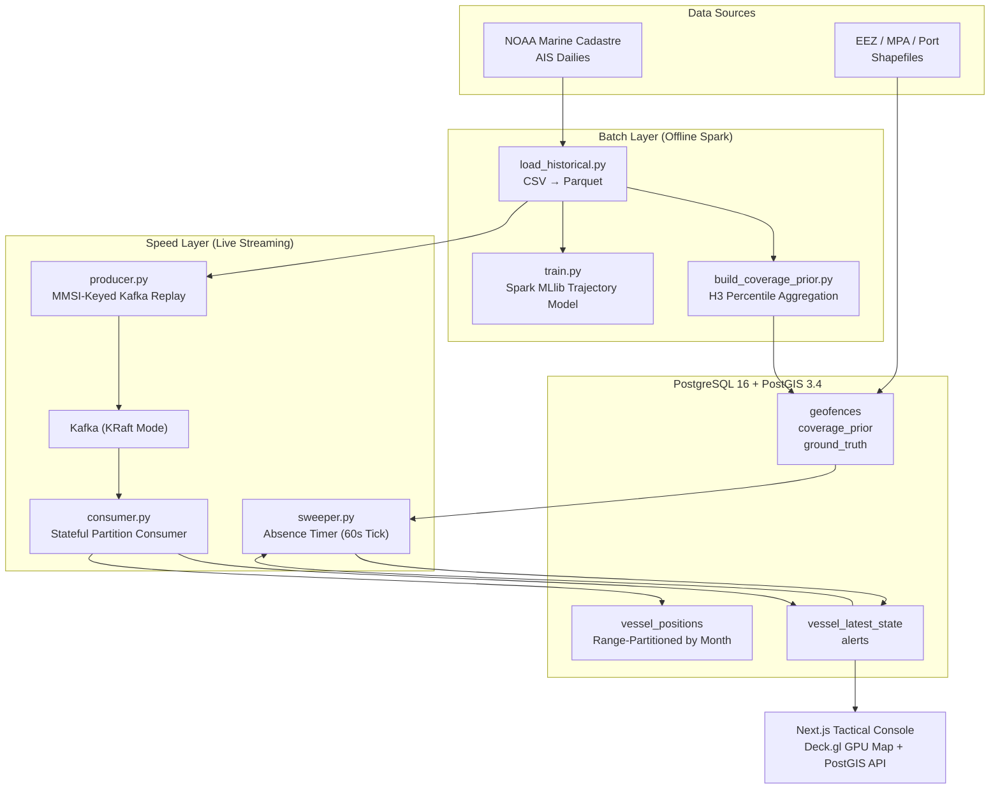

# Real-Time Dark Vessel Detection System

A big data streaming and anomaly detection architecture designed to detect **dark vessels** (vessels that deliberately disable or falsify AIS broadcasts) while distinguishing genuine illicit behaviour from terrestrial receiver coverage drop-offs.

---

## Architecture Overview



---

## Quickstart

### 1. Prerequisites
- Docker Engine 24+ & Docker Compose v2
- Node.js 20+ & npm
- Python 3.11+ / uv

### 2. Environment Setup
```bash
cp .env.example .env

# Start core services (Kafka KRaft, PostGIS)
make up

# Check status of topics and database
make topics
```

### 3. Launch Surveillance Dashboard (Next.js)
```bash
# Option A: Run locally with hot reloading
cd frontend && npm run dev

# Option B: Run containerized
make dashboard
```
Open **`http://localhost:3000`** to view the live tactical maritime surveillance console.

### 4. Run Unit Tests
```bash
make test
```

---

## Directory Structure

```
.
├── Makefile                     # Developer automation targets
├── docker-compose.yml           # Multi-service infrastructure orchestration
├── .env.example                 # Configuration blueprint
├── docs/                        # Architecture, PRD, security, deployment docs
├── db/init/                     # PostGIS schemas and role initialization SQL
├── data/                        # Shared local datasets (raw, parquet, geofences)
├── scripts/                     # Health check and topic bootstrap shell scripts
├── backend/                     # Python Streaming & Big Data Engine
│   ├── requirements.txt         # Pinned Python dependencies
│   ├── data_pipeline/           # Ingestion, validation contracts, anomaly injection
│   │   └── validate.py          # Single shared AIS validation & sentinel normalization
│   ├── streaming/               # Kafka replay producer, consumer, and absence sweeper
│   │   ├── producer.py          # MMSI-keyed Kafka stream replay
│   │   ├── consumer.py          # Stateful batch upsert to PostGIS
│   │   └── sweeper.py           # Absence-triggered gap detector
│   ├── detection/               # Great-circle math, rules, and ML anomaly models
│   ├── analysis/                # Spark batch jobs (coverage prior percentiles)
│   ├── monitoring/              # Observability, throughput, and consumer lag telemetry
│   ├── models/                  # Saved ML models and scaler pipelines
│   └── tests/                   # Pytest unit & integration test suite
└── frontend/                    # Next.js + Deck.gl + Vanilla CSS Tactical Console
    ├── app/                     # App router pages and API Route Handlers
    ├── components/              # DeckMap, AlertFeed, HudStats, VesselDrawer
    └── lib/db.ts                # PostgreSQL connection pool
```
