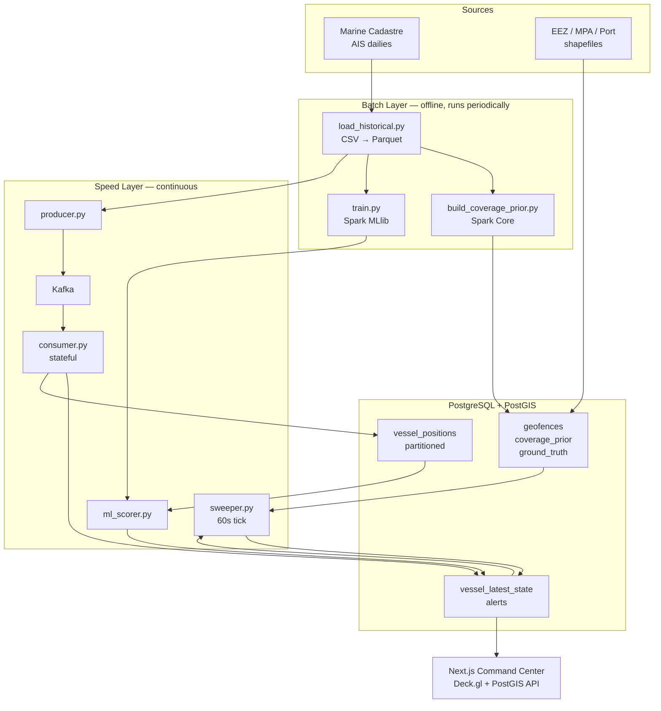
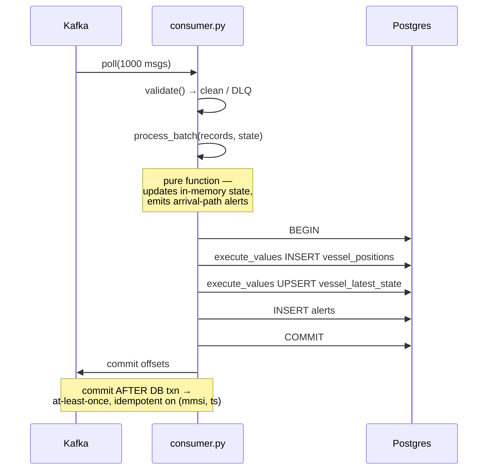
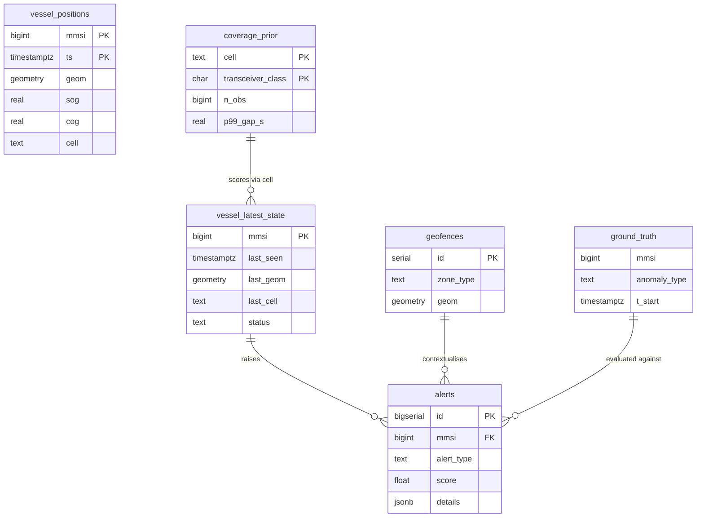

# System Architecture

---

## 1. Overview

The system is a lambda-style pipeline: a **batch layer** that learns what normal AIS reporting looks like in each part of the ocean, and a **speed layer** that scores live traffic against what the batch layer learned.

The batch layer is not an afterthought — it is what makes the speed layer meaningful. Without the coverage prior, a live gap detector reports receiver geometry rather than vessel behaviour.



---

## 2. The Central Design Decision

> [!IMPORTANT]
> **A dark vessel emits nothing. Therefore no arriving message can trigger its detection.**

This single fact determines the architecture. The system cannot be a pure stream-processing pipeline, because the event of interest is the *absence* of events.

The resolution is a two-path design:

| Path | Trigger | Detects |
|---|---|---|
| **Arrival path** (`consumer.py`) | An AIS message arrives | Spoofing, MMSI collision, impossible speed — anomalies *present in* data |
| **Absence path** (`sweeper.py`) | A 60-second timer | Dark vessels, loitering — anomalies *defined by missing or static* data |

The arrival path maintains `vessel_latest_state`; the absence path scans it. The state table is the interface between them, and it is deliberately small — a few thousand rows regardless of how much history accumulates — so the sweeper's full-table scan stays cheap forever.

---

## 3. Component Responsibilities

### 3.1 Producer — `streaming/producer.py`

Replays cleaned Parquet as a simulated live feed.

- **Keys every message by MMSI.** All records for one vessel therefore land in one partition, preserving per-vessel ordering while allowing six-way parallelism. Without this, stateful processing is simply incorrect.
- **Injects late arrivals.** `--late-fraction 0.05 --max-lateness 90s`. Strictly ordered replay hides the hardest part of stream processing; this exercises the out-of-order handling that real deployments require.
- **Decouples event time from wall-clock.** `--speedup 720` replays a day in two minutes while preserving original `BaseDateTime` values, so all downstream event-time logic stays correct.
- `--seed` for deterministic demos.

### 3.2 Broker — Kafka

| Topic | Partitions | Key | Retention | Contents |
|---|---|---|---|---|
| `ais.positions.raw` | 6 | MMSI | 24 h | Unvalidated records |
| `ais.positions.clean` | 6 | MMSI | 24 h | Validated records |
| `ais.positions.dlq` | 1 | MMSI | 7 d | Rejects + reason |
| `ais.alerts` | 3 | MMSI | 7 d | Detector output |

Partition count 6 is the parallelism ceiling for the consumer group. Six is chosen to exceed any realistic consumer count here while keeping per-partition state manageable.

### 3.3 Validator — `data_pipeline/validate.py`

A single pure function imported by the producer, the consumer, and the batch job. One definition of "clean" for all three; no drift between the training distribution and the serving distribution.

Rejects go to the DLQ with a reason code. The reject rate is a first-class metric — a sudden spike indicates a malformed upstream file long before the symptom reaches the dashboard.

### 3.4 Consumer — `streaming/consumer.py`



Two decisions carry most of the weight here.

**Offsets commit after the database transaction.** This gives at-least-once delivery: a crash between commit points replays a batch. The position insert is idempotent on `(mmsi, ts)` via `ON CONFLICT DO NOTHING`, so replay is harmless. The reverse order would give at-most-once and silently lose data on crash.

**Inserts are batched with `execute_values`.** Row-by-row `INSERT` is typically 50–100× slower and is the single most common reason a pipeline of this shape fails to keep up with its producer.

In-memory state is checkpointed to Postgres every 30 seconds so a restart resumes rather than cold-starting.

### 3.5 Sweeper — `detection/sweeper.py`

Runs every 60 seconds. One SQL statement joining `vessel_latest_state` to `coverage_prior` and `geofences`:

```
gap_score = seconds_since_last_seen / p99_gap_s(cell, transceiver_class)
```

Three guards distinguish this from a naive threshold:

1. **Coverage gating** — cells with `n_obs < 500` are suppressed entirely. No prior means no claim.
2. **Per-cell, per-class thresholds** — a Class B vessel offshore has a completely different normal reporting interval from a Class A vessel in a harbour approach.
3. **Deduplication** — a unique index on `(mmsi, alert_type, hour)` plus a 6-hour lookback. Without this, one dark vessel generates an alert every 60 seconds indefinitely.

### 3.6 ML scorer — `detection/ml_scorer.py`

Operates on completed 1-hour tumbling windows per MMSI, not on individual messages. Features are trajectory-level by nature (`sog_std`, `cog_circular_std`, `path_tortuosity`, `gap_score_max`) and are meaningless on a single ping.

Feature vectors are persisted to `vessel_features` and used for both training and serving, which eliminates train/serve skew by construction rather than by discipline.

### 3.7 Dashboard — `dashboard/app.py`

Reads `vessel_latest_state` and the last ~200 alerts. Never queries `vessel_positions` except on an explicit track drill-down scoped to one MMSI and a bounded time range.

---

## 4. Data Contracts

### 4.1 Kafka message — `ais.positions.clean`

```json
{
  "schema_version": 1,
  "mmsi": 367123456,
  "ts": "2024-01-15T08:23:11Z",
  "lat": 37.8021,
  "lon": -122.4056,
  "sog": 12.4,
  "cog": 187.3,
  "heading": 186,
  "vessel_type": 70,
  "transceiver_class": "A",
  "nav_status": 0,
  "cell": "85283473fffffff",
  "ingested_at": "2024-01-15T08:23:11.442Z"
}
```

`schema_version` is present from day one. Adding it later requires handling untagged messages forever.

`sog`, `cog`, `heading`, `vessel_type` and `nav_status` are nullable — AIS sentinel values (SOG 102.3, COG 360, heading 511) are normalised to `null` by the validator rather than passed through as numbers, which would otherwise poison every aggregate.

### 4.2 DLQ message — `ais.positions.dlq`

```json
{
  "reason": "position_unavailable",
  "raw": { "...": "original record verbatim" },
  "rejected_at": "2024-01-15T08:23:11.442Z"
}
```

Reason codes: `bad_mmsi`, `coord_out_of_range`, `position_unavailable`, `missing_timestamp`, `duplicate`, `parse_error`.

### 4.3 Alert record

```json
{
  "mmsi": 367123456,
  "alert_type": "dark_vessel",
  "score": 3.7,
  "severity": "high",
  "detected_at": "2024-01-15T11:31:00Z",
  "last_lat": 37.8021,
  "last_lon": -122.4056,
  "details": {
    "gap_s": 11340,
    "p99_gap_s": 3065,
    "cell": "85283473fffffff",
    "coverage_n": 8421,
    "zone": "Greater Farallones NMS",
    "transceiver_class": "A"
  }
}
```

`details` carries the full evidence for the alert. An alert a human cannot audit is not actionable, and the report needs to show worked examples.

Severity bands: `score < 2` low, `2–5` medium, `> 5` high.

---

## 5. Storage Model



### Hot / cold separation

This is the decision that keeps the dashboard responsive as history grows.

| | `vessel_positions` (cold) | `vessel_latest_state` (hot) |
|---|---|---|
| Rows | 10⁷–10⁹ | 10³–10⁴ |
| Access | Append-only; read only in batch or single-vessel drill-down | Upserted continuously; scanned every 60 s |
| Partitioning | Range by month | None needed |
| Indexes | BRIN on `ts`, GIST on `geom` | PK on `mmsi`, B-tree on `last_seen`, GIST on `last_geom` |

BRIN rather than B-tree on `ts` is deliberate: for append-only time-ordered data, BRIN is typically a few hundred kilobytes where B-tree would be gigabytes, with comparable range-scan performance.

---

## 6. Time Semantics

Three distinct clocks, and conflating them is a common source of subtle bugs.

| Clock | Field | Used for |
|---|---|---|
| **Event time** | `ts` (AIS `BaseDateTime`) | All detection logic, all windowing, all gap arithmetic |
| **Ingest time** | `ingested_at` | Pipeline latency measurement only |
| **Wall clock** | `now()` | Sweeper tick only |

The sweeper is the one place where wall clock touches detection logic, and only because "how long since we last heard from this vessel" is inherently a present-tense question. During accelerated replay the sweeper uses a **simulated clock** derived from the maximum observed event time, not `now()` — otherwise a 720× replay would mark every vessel dark within seconds.

End-to-end latency is `alert.detected_at − position.ts` measured in ingest time, reported in the health tab.

---

## 7. Failure Modes

| Failure | Detection | Behaviour | Recovery |
|---|---|---|---|
| Consumer crashes | Kafka group timeout | Partitions rebalance; uncommitted batch replays | Automatic; idempotent inserts make replay safe |
| Postgres unavailable | Connection error | Consumer stops committing offsets, retries with `tenacity` backoff | Kafka retains 24 h; consumer resumes from last commit |
| Kafka unavailable | Producer/consumer error | Producer blocks; consumer idles | Automatic on broker return |
| Consumer lags behind producer | `consumer_lag` metric | Alerts delayed but not lost | Reduce `--speedup`, or scale consumers up to 6 |
| Coverage prior missing for a cell | `n_obs < 500` | Cell suppressed from alerting, shown shaded on the coverage tab | Extend the historical window and rebuild the prior |
| Model file missing or feature mismatch | Assertion on load | ML scorer exits; rule-based detection continues unaffected | Retrain; rules are the fallback by design |
| Malformed upstream file | DLQ rate spike | Bad records isolated; pipeline continues | Inspect DLQ, fix loader |
| Duplicate replay after crash | — | `ON CONFLICT DO NOTHING` absorbs it | None needed |

> [!NOTE]
> Rule-based and ML detection are deliberately independent. The ML path can fail entirely without degrading the core capability. This ordering also matches the MVP cut-line: rules ship, ML is an enhancement.

---

## 8. Scaling Path

The current design targets a single development machine. The path beyond it, in order of what binds first:

1. **Consumer throughput** — scale the consumer group to 6 instances (the partition count). No code change; MMSI keying already guarantees per-vessel affinity.
2. **Beyond 6 consumers** — raise partition count and repartition. Requires a brief pause; MMSI keying means a rehash moves vessels between partitions, so in-memory state must be flushed first.
3. **Write throughput** — move `vessel_positions` to TimescaleDB hypertables with native compression, or offload to object storage in Parquet with Postgres retaining only recent partitions.
4. **Batch scale** — Spark already scales horizontally; add workers.
5. **The genuine next step, methodologically** — SAR fusion. Correlating Sentinel-1 unmatched detections against AIS is what turns "AIS gap" into actual dark vessel confirmation. This is out of scope here and named explicitly in the report's limitations.
