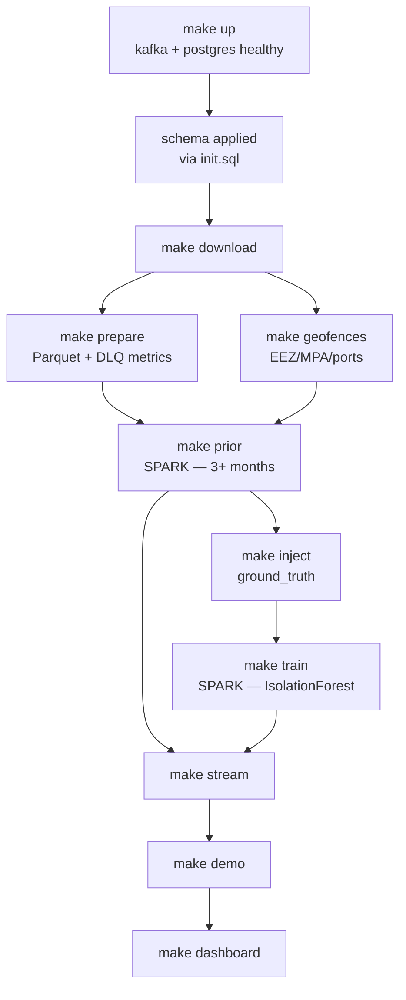

# Deployment & Operations

---

## 1. Prerequisites

| Requirement | Minimum | Recommended |
|---|---|---|
| RAM | 8 GB | 16 GB |
| Free disk | 30 GB | 100 GB (a year of AIS is large) |
| CPU | 4 cores | 8 cores |
| Docker Engine | 24.0 | latest |
| Docker Compose | v2 | v2 |
| Python (host, for the loader) | 3.11 | 3.11 |

> [!NOTE]
> 8 GB works because Spark and the live stream never run at the same time — Compose profiles enforce this. The batch profile is the memory-hungry one.

---

## 2. Cold Start

```bash
git clone <repo> && cd dark-vessel-detection

cp .env.example .env
sed -i "s/^POSTGRES_PASSWORD=.*/POSTGRES_PASSWORD=$(openssl rand -base64 32)/" .env
sed -i "s/^DB_READ_PASSWORD=.*/DB_READ_PASSWORD=$(openssl rand -base64 32)/" .env

python -m venv .venv && source .venv/bin/activate
pip install -r requirements.txt

make up          # start core services
make download    # fetch AIS + geofences  (~20 min, network-bound)
make prepare     # CSV -> Parquet, validate  (~10 min)
make geofences   # load EEZ / MPA / ports into PostGIS
make prior       # build coverage prior (batch profile)  (~15-30 min)
make inject      # generate labelled synthetic anomalies
make stream      # start consumer + sweeper
make demo        # deterministic replay
make dashboard   # http://127.0.0.1:3000
```

Target: under 10 minutes to a working demo if `make download` and `make prior` are already cached.

---

## 3. Compose Profiles

```bash
docker compose up -d                     # default: kafka, postgres
docker compose --profile stream up -d    # + consumer, sweeper, scorer
docker compose --profile batch up -d     # + spark-master, spark-worker
docker compose --profile ui up -d        # + next.js frontend
```

| Profile | Services | Peak RAM | When |
|---|---|---|---|
| (default) | kafka, postgres | ~2.0 GB | Always |
| `stream` | + consumer, sweeper, ml_scorer | ~2.5 GB | Live demo |
| `batch` | + spark-master, spark-worker | ~5.5 GB | Coverage prior, analytics, training |
| `ui` | + frontend (next.js) | +0.5 GB | Whenever you want the dashboard |

> [!IMPORTANT]
> Do not run `stream` and `batch` simultaneously on an 8 GB machine. `make prior` stops stream services before starting Spark and restarts them afterwards.

---

## 4. Bootstrap Order

Order matters — several steps depend on artifacts produced by earlier ones.



**The prior must exist before the sweeper runs.** Without rows in `coverage_prior`, the sweeper's join returns nothing and you will see zero alerts — which looks like a bug but is the coverage gate working exactly as designed. `make stream` checks for this and fails with a clear message rather than starting silently.

---

## 5. Makefile

```make
.PHONY: help up down logs reset
.DEFAULT_GOAL := help

help:
	@grep -E '^[a-zA-Z_-]+:.*?## .*$$' $(MAKEFILE_LIST) | \
	  awk 'BEGIN {FS=":.*?## "}; {printf "  \033[36m%-14s\033[0m %s\n", $$1, $$2}'

up:              ## start core services
	docker compose up -d
	@./scripts/wait_healthy.sh kafka postgres
	@./scripts/create_topics.sh

down:            ## stop everything, keep volumes
	docker compose --profile stream --profile batch --profile ui down

nuke:            ## stop everything and delete volumes
	docker compose --profile stream --profile batch --profile ui down -v

download:        ## fetch AIS + geofence sources
	python -m data_pipeline.download --year 2024 --months 1,2,3

prepare:         ## CSV -> validated Parquet
	python -m data_pipeline.load_historical --in data/raw --out data/parquet

geofences:       ## load shapefiles into PostGIS
	python -m data_pipeline.load_geofences

prior:           ## build coverage prior (stops stream, uses Spark)
	@docker compose --profile stream stop
	docker compose --profile batch up -d
	@./scripts/wait_healthy.sh spark-master
	docker compose exec spark-master spark-submit \
	  --master spark://spark-master:7077 \
	  --driver-memory 2g --executor-memory 2g \
	  /app/backend/analysis/build_coverage_prior.py --months 2024-01,2024-02,2024-03
	docker compose --profile batch stop

inject:          ## generate labelled synthetic anomalies
	python -m data_pipeline.inject_anomalies --seed 42 --n-events 200

train:           ## train IsolationForest
	docker compose --profile batch up -d
	docker compose exec spark-master spark-submit /app/backend/detection/train.py
	docker compose --profile batch stop

stream:          ## start consumer + sweeper + scorer
	@./scripts/check_prior.sh
	docker compose --profile stream up -d

demo:            ## deterministic replay
	python -m streaming.producer --seed 42 --speedup 720 \
	  --window 2024-01-15/2024-01-16

dashboard:       ## start Next.js surveillance dashboard
	docker compose --profile ui up -d
	@echo "http://127.0.0.1:3000"

reset:           ## clear runtime state, keep reference data
	docker compose exec -T postgres psql -U postgres -d ais -c \
	  "TRUNCATE vessel_positions, vessel_latest_state, alerts, vessel_features;"
	docker compose exec -T kafka kafka-consumer-groups \
	  --bootstrap-server localhost:9092 --group detector \
	  --topic ais.positions.clean --reset-offsets --to-earliest --execute
	@echo "reset complete — coverage_prior, geofences, ground_truth preserved"

evaluate:        ## precision/recall + ablation
	python -m evaluation.evaluate --out docs/results/

test:            ## unit + integration
	pytest tests/ -v --cov=. --cov-report=term-missing

logs:            ## tail everything
	docker compose logs -f --tail=100
```

> [!NOTE]
> `reset` deliberately preserves `coverage_prior`, `geofences` and `ground_truth`. Those take 30+ minutes to rebuild and never change between demo runs. Only `nuke` removes them.

---

## 6. Health Verification

`scripts/wait_healthy.sh` polls container health rather than sleeping a fixed interval:

```bash
#!/usr/bin/env bash
set -euo pipefail
for svc in "$@"; do
  printf "waiting for %s" "$svc"
  for i in $(seq 1 60); do
    status=$(docker compose ps --format json "$svc" | jq -r '.[0].Health // "none"')
    if [[ "$status" == "healthy" ]]; then echo " ok"; break; fi
    printf "."; sleep 2
    if [[ $i -eq 60 ]]; then echo " TIMEOUT"; exit 1; fi
  done
done
```

Manual checks:

```bash
# schema present
docker compose exec postgres psql -U postgres -d ais -c "\dt"

# topics created
docker compose exec kafka kafka-topics --bootstrap-server localhost:9092 --list

# messages flowing
docker compose exec kafka kafka-console-consumer \
  --bootstrap-server localhost:9092 --topic ais.positions.clean \
  --max-messages 3 --from-beginning

# consumer keeping up (LAG column)
docker compose exec kafka kafka-consumer-groups \
  --bootstrap-server localhost:9092 --group detector --describe

# state populating
docker compose exec postgres psql -U postgres -d ais -c \
  "SELECT count(*), max(last_seen) FROM vessel_latest_state;"

# alerts firing
docker compose exec postgres psql -U postgres -d ais -c \
  "SELECT alert_type, count(*) FROM alerts GROUP BY 1;"
```

---

## 7. Runbook

### Demo procedure

```bash
make reset
make stream
make dashboard         # open, confirm empty map
make demo              # in a second terminal
```

Expect: vessels appear within ~10 s; first alerts within 60–120 s of simulated time crossing a threshold.

Rehearse this at least once before presenting. The most common demo failure is a stale consumer group offset causing the map to stay empty — `make reset` prevents it.

### Rebuilding the coverage prior

Needed when the historical window extends, the H3 resolution changes, or the confidence threshold is retuned.

```bash
make prior
docker compose exec postgres psql -U postgres -d ais -c \
  "SELECT count(*) FILTER (WHERE n_obs >= 500) AS confident,
          count(*) AS total FROM coverage_prior;"
```

If `confident/total` is below ~0.4, either the historical window is too short or the H3 resolution is too fine. Coarsen to resolution 4 and rebuild.

### Adding a month of data

```bash
python -m data_pipeline.download --year 2024 --months 4
make prepare
docker compose exec postgres psql -U postgres -d ais -c \
  "CREATE TABLE vessel_positions_2024_04 PARTITION OF vessel_positions
   FOR VALUES FROM ('2024-04-01') TO ('2024-05-01');"
make prior   # optional; more history improves the prior
```

Partitions are created manually here. `pg_partman` would automate it but adds an extension dependency for a system with a fixed, known date range.

### Backup

```bash
# reference data only — expensive to rebuild, small to store
docker compose exec -T postgres pg_dump -U postgres -d ais \
  -t coverage_prior -t geofences -t ground_truth \
  | gzip > backups/reference_$(date +%F).sql.gz

# restore
gunzip -c backups/reference_2024-01-15.sql.gz | \
  docker compose exec -T postgres psql -U postgres -d ais
```

`vessel_positions` is not backed up — it is regenerable from Parquet, and a backup would be enormous.

---

## 8. Troubleshooting

| Symptom | Likely cause | Fix |
|---|---|---|
| **Map empty, producer running** | Consumer group offset at end of topic | `make reset`, restart |
| **Zero alerts ever** | `coverage_prior` empty or all cells below threshold | Check `SELECT count(*) FROM coverage_prior WHERE n_obs >= 500` — if zero, run `make prior` |
| **Thousands of alerts immediately** | Coverage gate bypassed, or real-clock sweeper during accelerated replay | Confirm the sweeper is using simulated time; confirm the prior join is not a LEFT JOIN |
| **Consumer lag grows without bound** | Row-by-row inserts, or `--speedup` too aggressive | Confirm `execute_values` batching; lower speedup |
| **`OOMKilled` on spark-worker** | Executor memory exceeds `mem_limit` | Set `--executor-memory` to ~70% of the container limit; process month by month |
| **PySpark version mismatch error** | Host `pyspark` ≠ container Spark | Pin both to 3.5.1 |
| **`relation "vessel_positions_2024_02" does not exist`** | Missing partition | Create it (see §7) |
| **Dashboard slow / freezes** | Folium/Leaflet DOM in use, or querying `vessel_positions` | Must be Deck.gl; must query `vessel_latest_state` only |
| **`FATAL: password authentication failed`** | `.env` changed after the volume was initialised | `make nuke` then `make up` (destroys data), or `ALTER ROLE` manually |
| **Kafka won't start, cluster ID mismatch** | KRaft volume from a previous config | `docker compose down -v` for the kafka volume specifically |
| **Same MMSI in two partitions** | Producer not keying by MMSI | Fix the producer; this silently corrupts all stateful logic |
| **DLQ rate above 10%** | Wrong year's column schema | Inspect DLQ reasons; adjust the loader's column mapping |
| **Alert feed repeats one vessel** | Deduplication index missing | Confirm the unique index on `(mmsi, alert_type, hour)` exists |

---

## 9. Monitoring

`monitoring/metrics.py` writes to `pipeline_metrics` every 10 s:

| Metric | Healthy | Investigate |
|---|---|---|
| `msgs_consumed_per_s` | > 3,000 | < 1,000 |
| `consumer_lag` | < 10,000 | > 100,000 or rising steadily |
| `dlq_rate` | < 2% | > 5% |
| `db_batch_ms_p95` | < 200 ms | > 1,000 ms |
| `e2e_latency_s_p95` | < 90 s | > 300 s |
| `active_vessels` | stable | sudden drop |
| `alerts_per_1k_vessel_hours` | < 5 | > 20 |

The health tab renders these. Two of them — sustained lag growth and DLQ spikes — are the leading indicators for every other failure in the table above, so check them first when something looks wrong.

---

## 10. CI

```yaml
name: ci
on: [push, pull_request]
jobs:
  test:
    runs-on: ubuntu-latest
    steps:
      - uses: actions/checkout@v4
      - uses: actions/setup-python@v5
        with: { python-version: "3.11", cache: pip }
      - run: pip install -r requirements.txt
      - run: ruff check .
      - run: bandit -r . -ll
      - run: pip-audit -r requirements.txt
      - run: pytest tests/ --cov=. --cov-fail-under=80
```

`testcontainers` spins up a real PostGIS instance for the integration tests, so spatial queries are exercised against Postgres rather than mocked. Kafka is mocked — the processing core is a pure function, which is the point of that design.

---

## 11. Beyond Local

Not required for this project, but the natural progression if it continues:

| Component | Local | Managed |
|---|---|---|
| Kafka | Container | MSK / Confluent Cloud |
| Spark | Compose | EMR / Databricks |
| Postgres | Container | RDS with PostGIS |
| Consumer | Container | ECS Fargate, scaled to partition count |
| Dashboard | Next.js local (port 3000) | Vercel / ECS behind an auth proxy |
| Secrets | `.env` | Secrets Manager |
| Metrics | Postgres table | CloudWatch / Prometheus + Grafana |

The migration is mostly mechanical because every connection is already driven by environment variables and the consumer is already horizontally scalable via Kafka partitions. The one genuine change is that the sweeper needs leader election so that multiple instances do not duplicate alerts — a Postgres advisory lock is sufficient.
