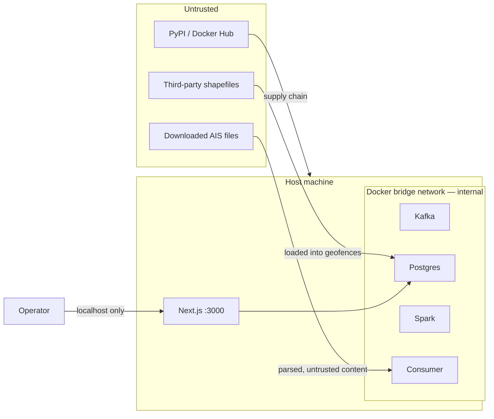

# Security

Scope note: this is a single-operator analytical system running locally, not an internet-facing service. The controls below are sized accordingly — but the threat model is written as though it might be deployed, because the gap between "local project" and "someone exposed port 5432" is one careless `docker compose` edit.

---

## 1. Trust Boundaries



The critical boundary is the Docker network edge. Nothing inside it should be reachable from outside the host.

---

## 2. Threat Model

| # | Threat | Vector | Likelihood | Impact | Response |
|---|---|---|---|---|---|
| T1 | Exposed database | `ports: 5432:5432` published on a network-visible interface | High | High | Bind to loopback only; strong generated password |
| T2 | Exposed broker | Kafka published without auth | Medium | High | Internal listener only; no host port in the default profile |
| T3 | Exposed dashboard | Next.js on `0.0.0.0` with no auth | High | Medium | Bind to `127.0.0.1`; auth required if ever exposed |
| T4 | Credentials in git | Passwords hardcoded in `docker-compose.yml` | High | High | `.env` file, gitignored; `.env.example` with placeholders |
| T5 | Malformed input crashes the pipeline | Corrupt CSV, hostile values in AIS fields | High | Low | Validation layer + DLQ; parser never trusts field types |
| T6 | SQL injection | String-formatted queries with AIS-derived values | Medium | High | Parameterised queries only; no f-string SQL |
| T7 | Path traversal | `--input` accepting arbitrary paths | Low | Medium | Resolve and confirm paths stay under the data root |
| T8 | Zip/decompression bomb | Downloaded archive expands to fill disk | Low | Medium | Inspect uncompressed size before extracting; cap it |
| T9 | Malicious shapefile | Crafted geometry triggering a GEOS/GDAL bug | Low | Medium | Pinned versions; validate geometries on load; known sources only |
| T10 | Supply chain | Compromised PyPI package or base image | Low | High | Exact pins, hash-locked requirements, digest-pinned images, `pip-audit` |
| T11 | Pickle deserialisation | Loading an untrusted `model.pkl` | Low | High | Only load models this repo produced; never accept externally supplied model files |
| T12 | Resource exhaustion | Runaway Spark job or unbounded consumer buffer | Medium | Medium | `mem_limit` on every container; bounded producer buffers |
| T13 | Licence violation | Non-commercial data used or redistributed improperly | Medium | Medium | Licences documented; raw data gitignored |

> [!IMPORTANT]
> T11 deserves specific attention. `joblib.load` executes arbitrary code during unpickling. The model file must only ever come from this repository's own training run. Never load a model someone sends you, and never fetch one from an untrusted URL.

---

## 3. Secrets Management

**Never in `docker-compose.yml`, never in git.**

`.env` (gitignored):

```bash
POSTGRES_USER=ais_app
POSTGRES_PASSWORD=          # generate: openssl rand -base64 32
POSTGRES_DB=ais
POSTGRES_HOST=postgres
KAFKA_BOOTSTRAP=kafka:9092
GFW_API_TOKEN=              # optional
DASHBOARD_PASSWORD=         # only if exposed beyond localhost
```

`.env.example` is committed with keys present and values empty.

Compose references them:

```yaml
environment:
  POSTGRES_PASSWORD: ${POSTGRES_PASSWORD:?POSTGRES_PASSWORD must be set}
```

The `:?` syntax fails the stack at startup with a clear message rather than silently defaulting to something weak.

`.gitignore` must include:

```
.env
data/raw/
data/parquet/
models/*.pkl
*.log
.streamlit/secrets.toml
```

Add a pre-commit hook running `detect-secrets` or `gitleaks`. Accidental credential commits are the single most common security failure in student projects, and rewriting git history afterwards is unpleasant.

---

## 4. Network Exposure

Default posture: **nothing is reachable from outside the host.**

```yaml
services:
  postgres:
    ports:
      - "127.0.0.1:5432:5432"      # loopback only — never "5432:5432"

  kafka:
    # no ports section at all in the default profile.
    # add "127.0.0.1:9092:9092" only when using host-based CLI tools.
    expose:
      - "9092"

  frontend:
    ports:
      - "127.0.0.1:3000:3000"
    environment:
      - NODE_ENV=production
```

> [!WARNING]
> `ports: "5432:5432"` binds to all interfaces. On a shared network, university wifi, or any host with a public IP, that database is reachable by anyone who scans for it. The `127.0.0.1:` prefix is not optional.

Verify with `ss -tlnp | grep -E '5432|9092|3000'` — every line should show `127.0.0.1`, not `0.0.0.0`.

---

## 5. Database Security

### Least privilege

The `init.sql` bootstrap runs as superuser; the application does not.

```sql
CREATE ROLE ais_app LOGIN PASSWORD :'app_password';
GRANT CONNECT ON DATABASE ais TO ais_app;
GRANT USAGE ON SCHEMA public TO ais_app;
GRANT SELECT, INSERT, UPDATE ON vessel_positions, vessel_latest_state, alerts TO ais_app;
GRANT SELECT ON geofences, coverage_prior, ground_truth TO ais_app;
GRANT USAGE ON ALL SEQUENCES IN SCHEMA public TO ais_app;

-- dashboard is read-only
CREATE ROLE ais_read LOGIN PASSWORD :'read_password';
GRANT CONNECT ON DATABASE ais TO ais_read;
GRANT USAGE ON SCHEMA public TO ais_read;
GRANT SELECT ON ALL TABLES IN SCHEMA public TO ais_read;
```

The dashboard connects as `ais_read`. A bug or injection in the UI layer then cannot modify or drop anything.

### Query safety

Parameterised queries, always:

```python
# correct
cur.execute("SELECT * FROM alerts WHERE mmsi = %s AND detected_at > %s", (mmsi, since))

# never
cur.execute(f"SELECT * FROM alerts WHERE mmsi = {mmsi}")
```

Next.js Route Handlers (`app/api/*`) accept query parameters from client filters. Validate MMSI as an integer and alert type against an allowlist before either reaches SQL — the dashboard route handlers are where client input becomes a query predicate. Always use parameterized queries with `$1, $2` via `pg`.

---

## 6. Input Validation as a Security Control

The validation layer described in the architecture is a correctness measure and a security measure at once. Downloaded AIS files are untrusted content.

```python
MAX_UNCOMPRESSED = 5 * 1024**3   # 5 GB

def safe_extract(zip_path: Path, dest: Path):
    dest = dest.resolve()
    with zipfile.ZipFile(zip_path) as z:
        total = sum(i.file_size for i in z.infolist())
        if total > MAX_UNCOMPRESSED:
            raise ValueError(f"archive expands to {total} bytes")
        for info in z.infolist():
            target = (dest / info.filename).resolve()
            if not target.is_relative_to(dest):        # path traversal
                raise ValueError(f"unsafe path: {info.filename}")
        z.extractall(dest)
```

CSV parsing specifies dtypes explicitly rather than inferring them, so a field containing unexpected content becomes a parse failure routed to the DLQ rather than an object column that propagates strangeness downstream.

Geometry validation on shapefile load:

```python
gdf = gdf[gdf.geometry.is_valid & ~gdf.geometry.is_empty]
gdf["geometry"] = gdf.geometry.buffer(0)      # repair self-intersections
```

---

## 7. Container Hardening

```yaml
services:
  consumer:
    build: .
    user: "1000:1000"              # non-root
    read_only: true
    tmpfs:
      - /tmp
    cap_drop:
      - ALL
    security_opt:
      - no-new-privileges:true
    mem_limit: 1g
    pids_limit: 200
```

Dockerfile practices:

```dockerfile
FROM python:3.11-slim@sha256:<digest>     # digest-pinned, not just tagged

RUN groupadd -r ais && useradd -r -g ais -u 1000 ais
WORKDIR /app

COPY requirements.txt .
RUN pip install --no-cache-dir -r requirements.txt

COPY --chown=ais:ais . .
USER ais
```

Digest pinning matters: `python:3.11-slim` is a moving target, so an image rebuilt in three months is not the image you tested against. This is a reproducibility property as much as a security one.

---

## 8. Supply Chain

1. **Exact version pins** in `requirements.txt` — already done.
2. **Hash locking** for anything beyond a course project: `pip-compile --generate-hashes`.
3. **Dependency audit** in CI:

```yaml
- run: pip install pip-audit && pip-audit -r requirements.txt
- run: |
    docker run --rm -v /var/run/docker.sock:/var/run/docker.sock \
      aquasec/trivy image --severity HIGH,CRITICAL ais-consumer:latest
```

4. **`ruff` and `bandit`** for static analysis. `bandit` specifically catches f-string SQL, `subprocess` with `shell=True`, and unsafe deserialisation — the three patterns most likely to appear in this codebase.

---

## 9. Data Governance

| Dataset | Licence | Constraint |
|---|---|---|
| Marine Cadastre AIS | US Government work, public domain | None; attribution courteous |
| NOAA MPA Inventory | Public domain | None |
| NGA World Port Index | Public domain | None |
| Marine Regions World EEZ v12 | CC BY-NC-SA 4.0 | **Non-commercial**; attribution; share-alike |
| Global Fishing Watch | CC BY-NC 4.0 | **Non-commercial**; attribution |

Two consequences:

- **Do not commit raw data to git.** Beyond licence questions, the repository becomes enormous. `data/` is gitignored; the loader downloads on demand.
- **State the non-commercial constraint in the report.** It is an academic project, so the licences permit the use, but the artifact cannot be commercialised without replacing those two sources.

### Privacy

AIS is publicly broadcast and MMSI identifies a vessel rather than a person. However, small-craft AIS combined with a track history is arguably personal data under GDPR for individually-owned vessels. For this project:

- Do not join AIS against vessel ownership registries.
- Do not publish alert output containing specific MMSIs outside the report.
- If screenshots appear in the report, redact or synthesise MMSI values.

---

## 10. If the Dashboard Is Ever Exposed

The default is localhost. If that changes, the following become mandatory rather than optional:

1. Authentication — NextAuth.js or OAuth reverse proxy.
2. TLS via Caddy or nginx; never plain HTTP over a network.
3. Rate limiting at the proxy or Next.js middleware.
4. CSRF protection on API routes.
5. Dashboard connects as `ais_read` — already the case, and this is why.
6. Structured access logging.

---

## 11. Pre-Deployment Checklist

```
[ ] .env exists, gitignored, no committed secrets (gitleaks clean)
[ ] All published ports bound to 127.0.0.1
[ ] Postgres password generated, not a default
[ ] Application connects as ais_app; dashboard as ais_read
[ ] No f-string SQL anywhere (bandit clean)
[ ] Containers run as non-root with cap_drop: ALL
[ ] mem_limit set on every service
[ ] Base images digest-pinned
[ ] pip-audit and trivy report no HIGH/CRITICAL
[ ] Archive extraction bounded and traversal-checked
[ ] Geometries validated on shapefile load
[ ] data/ and models/ gitignored
[ ] Dataset licences documented in the report
[ ] model.pkl loaded only from local training output
```
